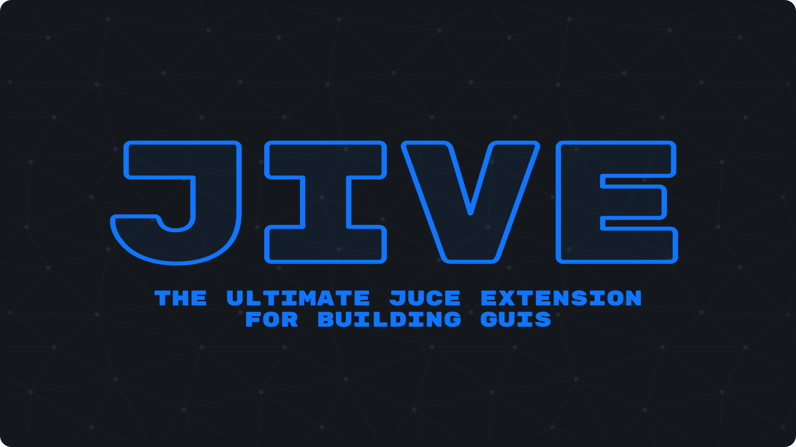

<p align="center">
  
</p>

<p align="center">
  
  
  
  
</p>

<p align="center">
  
  
</p>

<p align="center">
  
  
  
</p>

## About

JIVE completely overhauls the frontend development experience for JUCE projects by providing a high-level API for building and styling UIs.

Unlike in JUCE, where we build UIs entirely in C++, JIVE interprets XML files for layouts, and JSON files for styles similar to the way browsers load HTML and CSS. With the introduction of [Hot Reloading](#-hot-reloading) in JIVE 2.0, it's now easier than ever to build UIs for audio applications and plugins.

## [Layouts](./jive_layouts/)

JIVE parses XML files to build a hierarchy of `juce::Component`s for you, which you can then interact with through the `jive::GuiItem` class. The XML files are parsed to `juce::ValueTree`s which you can then change at runtime and JIVE will update the UI accordingly.

### MainView.xml

```xml
<Window width="600" height="400" padding="20">
  <Text>Hello, World!</Text>
</Window>
```

### Application.cpp

```cpp
jive::Interpreter interpreter;
auto guiItem = interpreter.interpret(jive::SourceFile{ "MainView.xml" });
juce::ValueTree& state = guiItem->state;
state["padding"] = "30 40";
state.getChildWithName("Text")["text"] = "Greetings!";
```

_See [jive_layouts/README.md](./jive_layouts/README.md) for an in-depth overview of layouts._

## [Styles](./jive_style_sheets/)

JIVE's powerful styling API parses JSON files and applies the rules they define to relevant components. CSS-like selectors allow for specific components, or classes of component to be styled differently.

### Styles.json

```jsonc
{
  "background": "#2A4747",
  "foreground": "#E0BAD7",

  // Style all <Button> elements
  "TextButton": {
    // Support for most CSS value syntax,
    // including gradients and shadows
    "background": "linear-gradient(180deg, #48BF84, #439775)",
    "foreground": "black",
    "font-size": 14,
    "shadow": "2px 2px 6px rgba(0, 0, 0, 0.5)",

    // Use nested styles for different interaction states
    ":hover": {
      "background": "#61D095"
    }
  },

  // Style an element with the ID "deleteButton"
  "#deleteButton": {
    "background": "#BF5649",
    "transition": "background 250ms ease-in-out"
  },

  // Chain states for more advanced selectors
  "#deleteButton:hover": {
    "background": "#D16D62"
  }
}
```

_See [jive_style_sheets/README.md](./jive_style_sheets/README.md) for an in-depth overview of style sheets._

## :fire: Hot Reloading

JIVE will observe changes in any of the source XML and JSON files it uses to build your UI and will automatically apply changes during runtime. This allows you to get instant feedback as you edit your UI code and see the changes in your application or plugin window applied live.

CMake users can use the [`jive_sources()`](./cmake/jive_sources.cmake) CMake function to specify which files should be used as JIVE sources. By default, these files will be hot-reloaded from disk during Debug builds, and will be embedded as a zip file in your binary for Release builds. Embedded zip bundles cannot be hot-reloaded.

See the [examples](./examples/) to try out hot reloading yourself, and see the `jive_sources()` function in action.

## Integration

JIVE contains several JUCE-module-formatted C++ libraries. You should add them in the same way you do any other 3rd-party JUCE module.

### CMake

The simplest way to add JIVE to your CMake is using [CPM](https://github.com/cpm-cmake/CPM.cmake):

```cmake
CPMAddPackage("gh:ImJimmi/JIVE#main")
```

Alternatively, use FetchContent or submodules.

Then, link the `jive_layouts` module to your target:

```cmake
target_link_libraries(my_juce_project
PRIVATE
    jive::jive_layouts
)
```

### Projucer

Click the "+" icon in the "Modules" panel and choose "Add a module from a specified folder...". Add all of the JIVE modules from wherever you cloned/downloaded JIVE to.

## Getting Started

See [the guides section](./docs/guides/) of the docs.

## Contributing

All contributions are welcome!

Please see the [Contribution Guidelines](./CONTRIBUTING.md) before submitting a PR. Be sure to check the [Issues Tab](https://github.com/ImJimmi/JIVE/issues) to avoid duplicates and to contribute to any ongoing conversation.
