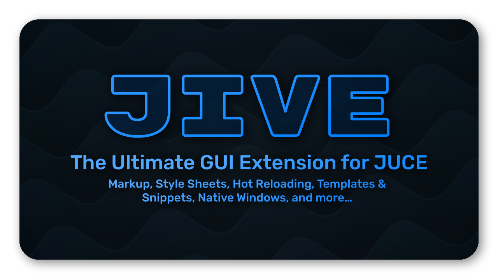
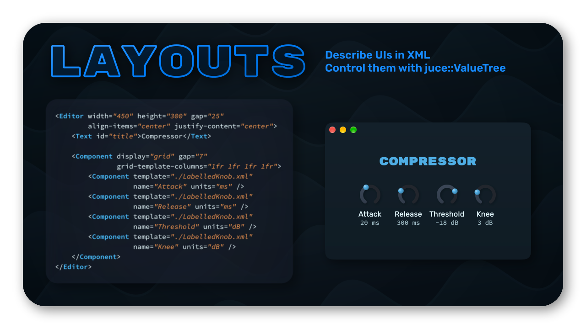
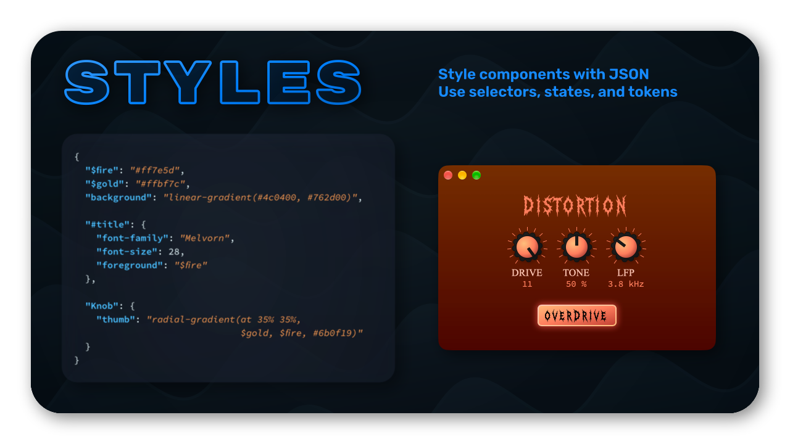
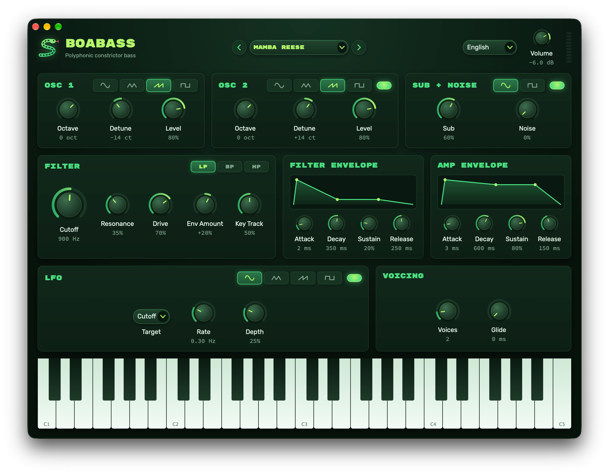

<p align="center">
  
</p>

<p align="center">
  
  
  
</p>

<p align="center">
  
  
</p>

<p align="center">
  
  
  
</p>

# About

JIVE completely overhauls the frontend development experience for JUCE projects by providing a high-level API for building and styling UIs.

Unlike in JUCE, where we build UIs entirely in C++, JIVE interprets XML files for layouts, and JSON files for styles similar to the way browsers load HTML and CSS. With the introduction of [Hot Reloading](#-hot-reloading) in JIVE 2.0, it's now easier than ever to build UIs for audio applications and plugins.

## Layouts



JIVE parses XML files to `juce::ValueTree` and builds a hierarchy of `juce::Component`s that mirror the tree, responding to changes.

Flex, Grid, and Block layouts allow for responsive designs, while the Box Model adds margins, padding, borders, and rounded corners to all components.

Templates are used to reuse views inside other views, and Snippets allow custom content to be passed to Templates.

_See [jive_layouts/README.md](./jive_layouts/README.md) for a technical overview of layouts, and see [docs/guides/02-Templates.md](./docs/guides/02-Templates.md) to learn how to use templates._

## Styles



JSON documents add styling rules for components. Selectors are used to specify which rules apply to which components. ID, Type, class, and pseudo-class selectors are all support. Selectors can also be combined and nested.

Tokens are specified in the root object to reuse values throughout the style sheet.

Style sheets can import other style sheets to combine and reuse rules across projects.

_See [jive_style_sheets/README.md](./jive_style_sheets/README.md) for a technical overview of style sheets, and see [docs/guides/03-Advanced Styling.md](./docs/guides/03-Advanced%20Styling.md) to learn how to create powerful style sheets, and [docs/guides/06-Advanced Widget Design.md](./docs/guides/06-Advanced%20Widget%20Design.md) to learn how to use custom widgets._

## :fire: Hot Reloading


JIVE watches XML and JSON files for changes and instantly applies them to the UI.

The [`jive_sources()`](./cmake/jive_sources.cmake) CMake function lists the files JIVE should use. Debug builds hot-reload them from disk. Release builds embed them in the binary as a zip file. Embedded files are fixed at build time.

_See the [examples](./examples/) to try hot reloading and to see `jive_sources()` in use._

## Native Windows

On macOS, windows created with JIVE default to having unified title bars. On Windows, the title bar colour will match the background colour by default.

JIVE supports native "materials" on macOS and Windows with the `"glass"` and `"tinted"` background keywords. See https://developer.apple.com/design/human-interface-guidelines/materials and https://learn.microsoft.com/en-us/windows/apps/design/signature-experiences/materials for details.

## Localisation

JIVE loads and manages `.strings` files to translate text in your app. Set the `"lang"` property on a component to change its language.

## Auto Parameter Attaching

Use `jive::Interpreter::autoAttachParameters()` to have JIVE automatically look for matching audio parameters for the widgets you add to your views.

# Getting Started

JIVE contains several JUCE-module-formatted C++ libraries. You should add them in the same way you do any other 3rd-party JUCE module.

## CMake

The simplest way to add JIVE to your CMake is using [CPM](https://github.com/cpm-cmake/CPM.cmake):

```cmake
CPMAddPackage("gh:ImJimmi/JIVE#main")
```

Alternatively, use FetchContent or submodules.

Then, link the `jive_layouts` module to your target:

```cmake
target_link_libraries(my_juce_project
PRIVATE
    jive::jive_layouts
)
```

The other JIVE modules are dependencies of `jive_layouts` so there's no need to list them all.

## Projucer

Click the "+" icon in the "Modules" panel and choose "Add a module from a specified folder...". Add all of the JIVE modules from wherever you cloned/downloaded JIVE to.

## Examples & Guides

The [examples/](./examples/) folder has several projects that demonstrate each of the major features of JIVE. There is also a demo synth plugin, [BoaBass](./examples/boabass/).



The [docs/guides/](./docs/guides/) folder has several written guides to help you get started with JIVE.

# Contributing

All contributions are welcome, but first:

- Read the [Code of Conduct](./CODE_OF_CONDUCT.md)
- Report JUCE bugs according to the [JUCE Framework's Contribution Guidelines](https://github.com/juce-framework/JUCE/blob/master/.github/contributing.md)

To submit a change:

- [Fork JIVE](https://github.com/ImJimmi/JIVE/fork)
- Create a new branch in your fork with your new feature, bug fix, etc.
- Build and test your changes by enabling the `JIVE_BUILD_EXAMPLES`, `JIVE_BUILD_TEST_RUNNER`, `JIVE_BUILD_BENCHMARKS`, `JIVE_ENABLE_PLUGINVAL`, and `JIVE_ENABLE_PROJUCER_PROJECTS` cmake settings
- Format your code with [ClangFormat](https://clang.llvm.org/docs/ClangFormat.html)
- Open a PR to merge your branch into JIVE's `main` branch
- Link your PR on the [JUCE forum thread](https://forum.juce.com/t/introducing-jive-the-ultimate-juce-extension-for-building-guis/56534) (recommended)

Your code may be rewritten, reformatted, or refactored to match the style and standards of the rest of the codebase.
