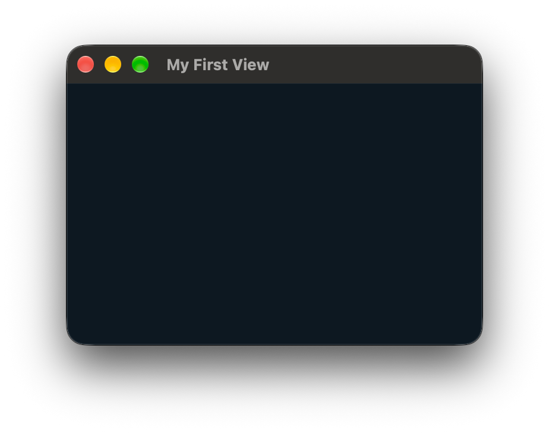
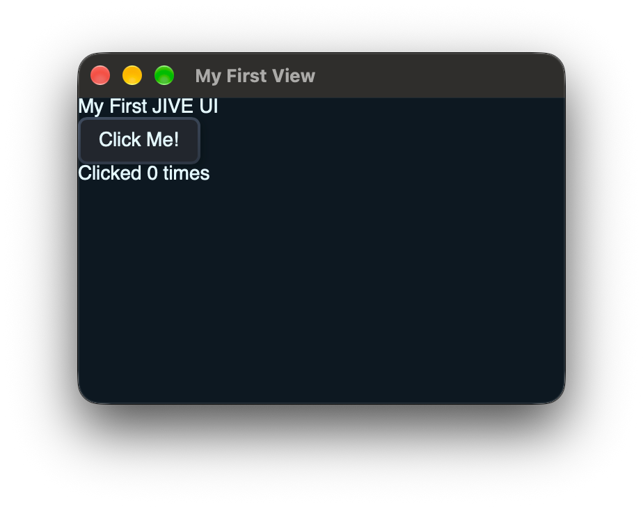
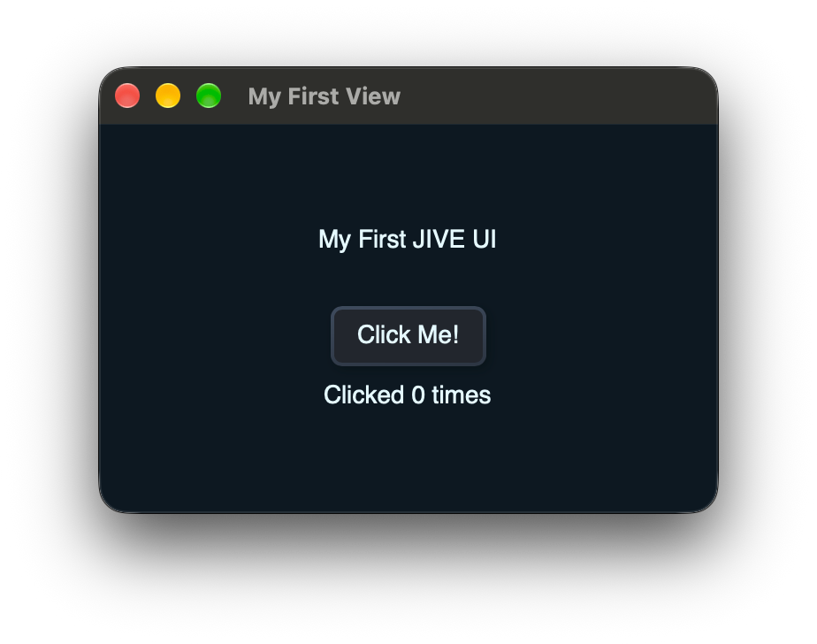
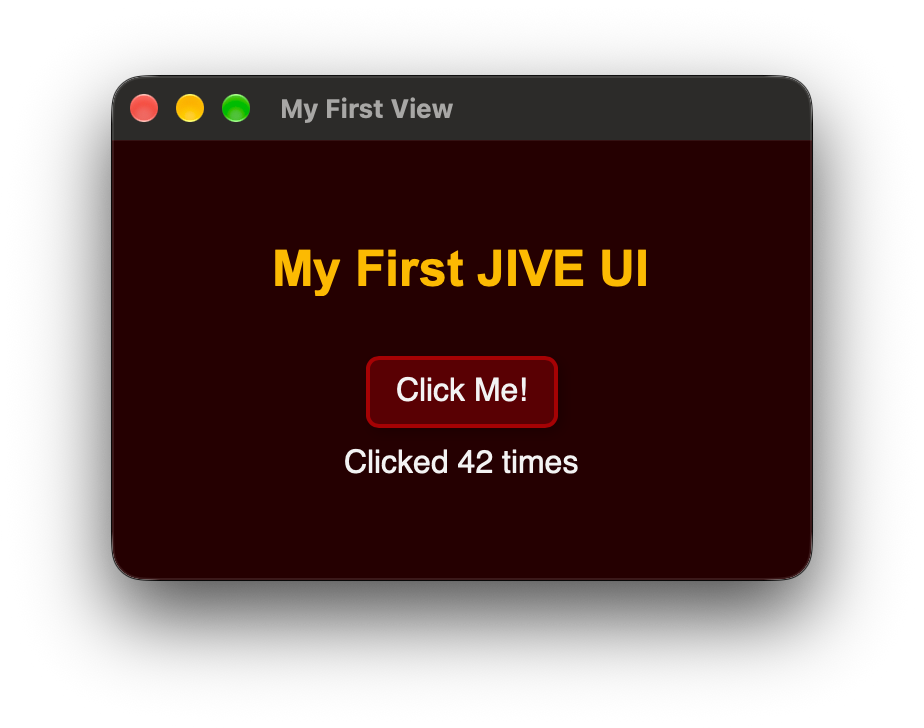

# Your First View

This guide walks you through building a very basic UI with JIVE, touching on layouts, styling, and events.

Before getting started, make sure you have followed the [integration](../../README.md#integration) steps.

## JIVE Sources

Before we can write our first view, we need to tell JIVE where to look for our source files.

It's best practice to keep your JIVE sources (XML and JSON files) separate from your other source code. The recommended practice is to use a `public/` directory next to your `source/` directory so everything under `public/` can be bundled in the Release binary.

### CMake

CMake users should use the `jive_sources()` function to specify where to look for JIVE sources:

```cmake
jive_sources(my-juce-project
SOURCES
  # Glob matching all files in the public/ directory
  "${PROJECT_SOURCE_DIR}/public/*"

  # Multiple globs can be provided if adding sources from other
  # places, e.g. a shared library of common components.
  # "${PROJECT_SOURCE_DIR}/modules/my-component-library/*"
)
```

Sources are always relative to the directory containing the `CMakeLists.txt` that called `jive_sources()`. E.g. in this case we would use `jive::SourceFile{ "public/some.file" }`, or `jive::SourceFile{ "modules/my-component-library/some-other.file" }`.

### Projucer

Projucer users will need to manually specify their JIVE source directories by creating one or more `jive::SourceRoot` objects.

```cpp
static const jive::SourceRoot projectSources{ juce::File{ "path/to/project" } };

// Multiple roots can be created if adding sources from other
// places, e.g. a shared library of common components.
// static const jive::SourceRoot componentSources{
//     juce::File{ "path/to/project" }.getChildFile("../my-component-library"),
// };
```

_You'll likely want to use a macro defined in your Projucer project, or `juce::File::getSpecialLocation()` rather than hard-coded paths._

You will need to handle the zip bundling yourself, and use the constructor of `jive::SourceRoot` that takes a pointer to a zip archive for Release builds. See [the example projects](../../examples/) for a working solution.

## `MainView.xml`

Create a file called `MainView.xml` in your project's `public/` directory. 

_You can use other names if you wish, JIVE has no restrictions on filenames so long as they can be found and parsed._

```xml
<Window name="My First View" width="350" height="220">
</Window>
```

**If you're building a plugin, replace `Window` with `Editor`.**

## Interpreting the View

To build our UI, we use a `jive::Interpreter` which is responsible for parsing our JIVE sources, building the hierarchy of components, and responding to any changes in the parsed `juce::ValueTree` or the original source file if hot reloading is enabled.

### Applications

```cpp
#include <jive_layouts/jive_layouts.h>

class Application final : public juce::JUCEApplication
{
public:
  // ...

  void initialise(const juce::String&) override
  {
    window = interpreter.interpret(jive::SourceFile{ "public/MainView.xml" });
  }

private:
  jive::Interpreter interpreter;
  std::unique_ptr<jive::GuiItem> window;
};
```

### Plugins

```cpp
#include <jive_layouts/jive_layouts.h>

class PluginProcessor final : public juce::AudioProcessor
{
public:
  juce::AudioProcessorEditor* createEditor() override
  {
    auto item = interpreter.interpret(jive::SourceFile{ "public/MainView.xml" },
                                      this);

    // The top-level jive::GuiItem is also a juce::AudioProcessorEditor,
    // so we can dynamic_cast to get the editor here (unless the
    // interpreter failed in which case pluginEditor will be nullptr)
    auto* pluginEditor = dynamic_cast<juce::AudioProcessorEditor*>(item.get());

    if (pluginEditor == nullptr)
      return nullptr; // Or return a fallback editor

    editor = item.release();

    return pluginEditor;
  }

private:
  jive::Interpreter interpreter;

  // We can't own the editor like we own the window in applications, as
  // it's owned by the JUCE base class, so we use a weak reference here
  // instead. Just remember to always check it still exists before trying
  // to access it.
  juce::WeakReference<jive::GuiItem> editor;
};
```

## First Run

Build and run your project and you should see a blank, 350x220 window appear.

If hot-reloading is enabled (which it is by default for Debug builds), you should now be able to edit `MainView.xml` and see the UI change immediately without having to rebuild.

<p align="center">
  
</p>

## Adding Widgets

Edit `MainView.xml` to add some child components to the window:

```xml
<Window name="My First View" width="350" height="220">
  <Text id="title">My First JIVE UI</Text>
  <Button id="counter-button">Click Me!</Button>
  <Text id="counter-label">Clicked 0 times</Text>
</Window>
```

<p align="center">
  
</p>

As you can see, the widgets automatically size and position themselves according to their content, mirroring their ordering from the XML source.

The `id` properties on each of the items will allow us to interact with them later to assign styles and event handlers. It's a good habit to get into to always add IDs to your UI elements.

The window, as with all containers, uses a [flex](https://docs.juce.com/master/classjuce_1_1FlexBox.html) layout by default, with a "column" direction so children are stacked vertically. We can specify some extra properties in our XML to customise the layout:

```xml
<Window
  name="My First View"
  width="350"
  height="220"
  align-items="center"
  justify-content="center"
>
  <Text id="title">My First JIVE UI</Text>
  <Button id="counter-button" margin="30 0 10 0">Click Me!</Button>
  <Text id="counter-label">Clicked 0 times</Text>
</Window>
```

`align-items` and `justify-content` are flex properties which specify the horizontal and vertical positioning of the window's children respectively.

`margin` on the button tells the layout engine how much space to leave around the button. In this case 30px above, and 10px below.

<p align="center">
  
</p>

## Event Handlers

To respond to when a user interacts with a widget, we need to assign event handlers. JIVE doesn't have any scripting capabilities, so event handling is done in C++.

_From here on out the code snippets will only show the application use-case, but all the same techniques also apply to plugins._

```cpp
class Application final : public juce::JUCEApplication
{
public:
  // ...

  void initialise(const juce::String&) override
  {
    // The onLoad callback is called anytime the interpreter builds or
    // updates the ValueTree state.
    // This is therefore where you should always assign handlers as
    // otherwise hot-reloading would invalidate the handlers.
    interpreter.onLoad = [this](jive::GuiItem& windowItem) {
      // Find the value-tree node representing the button we want to
      // attach the event to.
      juce::ValueTree buttonState = jive::findElementWithID(windowItem.state,
                                                            "counter-button");

      // We can now construct the handle for the button's on-click event
      // by giving jive::Event the button's ValueTree state and the name
      // of the event
      onClick.emplace(buttonState, "on-click");

      // Give the event a lambda to call when it's triggered.
      onClick->onTrigger = [this] {
        juce::ValueTree labelState = jive::findElementWithID(window->state,
                                                             "counter-label");

        // juce::ValueTree doesn't support inline text, so JIVE parses
        // inline text in XML files to a "text" property on the tree, so
        // we change that property here to update the label
        // <Text>Hello</Text> becomes <Text text="Hello"/>
        labelState.setProperty("text",
                               juce::String::formatted("Clicked %d times",
                                                       ++numClicks),
                               nullptr);
      };
    };

    window = interpreter.interpret(jive::SourceFile{ "public/MainView.xml" });
  }

private:
  jive::Interpreter interpreter;
  std::unique_ptr<jive::GuiItem> window;

  // jive::Event has no default constructor so we use an optional so it
  // can be constructed in the onLoad callback.
  std::optional<jive::Event> onClick;
  int numClicks = 0;
};
```

## Styling

To customise the styling of our UI, we use JIVE's style sheets API.

Create a new file in the `public/` directory called `Styles.json`:

```jsonc
{
  "background": "#250001",  // Window background colour
  "font-size": "16px",       // Global font size for all widgets
  "foreground": "#F3F3F3",  // Global foreground (text) colour

  // ID selector to style just the title text
  "#title": {
    "font-family": "Arial",
    "font-size": 25,
    "font-styles": "bold",
    "foreground": "#FCBA04"
  },

  // Type selector to style all buttons
  "Button": {
    "background": "#590004",
    "border": "#A50104",

    // Nested state specifier to change button's
    // styles when the mouse is hovered over it
    ":hover": {
      "background": "#A50104"
    }
  }
}
```

Then edit your view to tell it to use your new style sheet:

```xml
<Window
  name="My First View"
  width="350"
  height="220"
  align-items="center"
  justify-content="center"
  style="public/Styles.json"
>
    <!-- ... -->
</Window>
```

_You can also use `style="./Styles.json"`. JIVE treats `./` and `../` as relative paths to the current file, rather than relative to the root._

JIVE will automatically pick up the "style" property, find and parse the style sheet, and apply the rules to your UI. As with the XML sources, JIVE will hot-reload any changes to your JSON sources too.

<p align="center">
  
</p>
