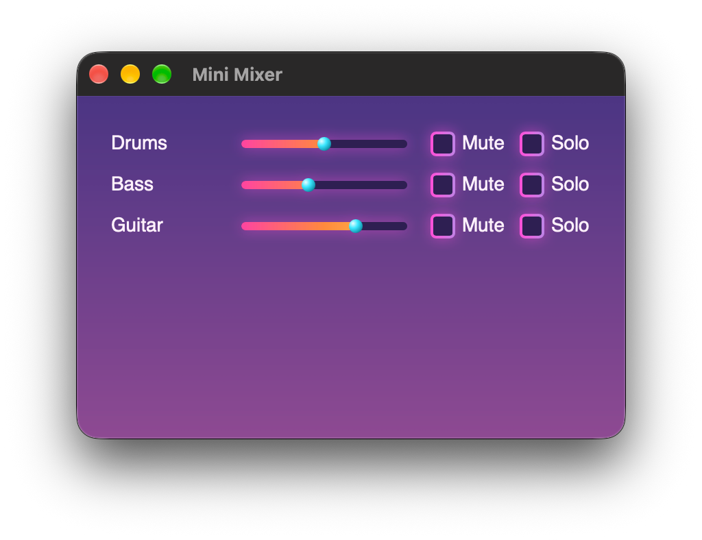

# Templates

This guide introduces Templates, which allow you to write reusable, configurable UI components.

_Have a read through [Your First View](./01-Your%20First%20View.md) if you haven't already, which introduces the basics of writing views._

## Mini Mixer

This is a basic mixer UI that has a list of tracks each with volume, mute, and solo controls.

```xml
<!-- public/MainView.xml -->
<Window
    width="400"
    height="250"
    padding="25"
>
  <Component class="track" flex-direction="row" gap="10" margin="0 0 10 0">
    <Text class="trackName" flex-grow="1">Drums</Text>
    <Slider class="volume" value="0.5" />
    <Checkbox class="mute-button">Mute</Checkbox>
    <Checkbox class="solo-button">Solo</Checkbox>
  </Component>

  <Component class="track" flex-direction="row" gap="10" margin="0 0 10 0">
    <Text class="trackName" flex-grow="1">Bass</Text>
    <Slider class="volume" value="0.4" />
    <Checkbox class="mute-button">Mute</Checkbox>
    <Checkbox class="solo-button">Solo</Checkbox>
  </Component>

  <Component class="track" flex-direction="row" gap="10" margin="0 0 10 0">
    <Text class="trackName" flex-grow="1">Guitar</Text>
    <Slider class="volume" value="0.7" />
    <Checkbox class="mute-button">Mute</Checkbox>
    <Checkbox class="solo-button">Solo</Checkbox>
  </Component>
</Window>
```

<p align="center">
  
</p>

The XML contains a lot of repetition as each track has the same layout. The only thing that varies between tracks is the name, and the initial slider value.

We can instead use a Template for the tracks to reduce the repetition and make it clearer what is actually different between each track.

## Templates

Templates are written in XML files, just like views. The key difference is that templates can have placeholders, like `{{ name }}` and _Snippets_, which we'll look at later.

Here's a template that describes our Track component:

```xml
<!-- public/Track.xml -->
<Component class="track" flex-direction="row" gap="10" margin="0 0 10 0">
    <Text class="trackName" flex-grow="1">{{ name }}</Text>
    <Slider class="volume" value="{{ initial-volume }}" />
    <Checkbox class="mute-button">Mute</Checkbox>
    <Checkbox class="solo-button">Solo</Checkbox>
</Component>
```

We can invoke our Track template in our main view to reduce the repetition:

```xml
<!-- public/MainView.xml -->
<Window
    width="400"
    height="250"
    padding="25"
>
  <Component template="public/Track.xml" name="Drums" initial-volume="0.5"/>
  <Component template="public/Track.xml" name="Bass" initial-volume="0.4"/>
  <Component template="public/Track.xml" name="Guitar" initial-volume="0.7"/>
  <Component template="public/Track.xml" name="Vocals" initial-volume="0.8"/>
  <Component template="public/Track.xml" name="Cow Bells" initial-volume="1.0"/>
</Window>
```

It's now much clearer to see the difference between the tracks, and adding new tracks only requires a single line per track.

## Nested Templates

Templates can invoke other templates, down to any depth.

```xml
<!-- public/templates/Card.xml -->
<Component class="card" padding="10">
  <Text class="title">{{ title }}</Text>
  <Snippet name="body"/>
</Component>
```

```xml
<!-- public/templates/Panel.xml -->
<Component class="panel">
  <Component template="./Card.xml" title="{{ title }}">
    <Snippet name="body">
      <Text>{{ body-text }}</Text>
    </Snippet>
  </Component>
</Component>
```

```xml
<!-- public/MainView.xml -->
<Window width="300" height="200">
  <Component
    template="public/templates/Panel.xml"
    title="Cool Templates!"
    body-text="Lorum Ipsum..."
  />
</Window>
```

After both the templates are invoked, this becomes:

```xml
<!-- public/MainView.xml -->
<Window width="300" height="200">
  <Component class="panel">
    <Component class="card" padding="10">
      <Text class="title">Cool Templates!</Text>
      <Text>Lorum Ipsum...</Text>
    </Component>
  </Component>
</Window>
```

## Placeholders

As shown above, placeholders can be used to pass information to templates when they're invoked.

Placeholders use the syntax `{{ name }}`. The whitespace within the braces is ignored, so `{{name}}` is also valid.

Placeholders are replaced character-for-character before the XML is parsed, so they can be used to replace any part of the XML document:

```xml
<{{ type-name }} width="100" {{ prop }}="2468">
  <Text>{{ message }}</Text>
</{{ type-name }}>
```

### Repeated Placeholders

Templates can use the same placeholder in multiple places. Every instance of the same placeholder will be replaced with the exact same string.

```xml
<Component id="{{ group-id }}">
  <Button id="{{ group-id }}-button"></Button>
  <Slider id="{{ group-id }}-slider"/>
</Component>
```

### Unused & Default Placeholders

If the invoker doesn't supply a value for a placeholder it will be removed and ignored.

Templates can give their placeholders default values which will be used if the invoker doesn't supply its own value. Default values are specified like `{{ name = "Default Value" }}`.

### Placeholders in Nested Templates

Placeholders in nested templates can only be set by the template that invokes them. To allow invokers of an outer template to supply values for placeholders in inner templates, they should be forwarded like so:

```xml
<!-- Inner.xml -->
<Component margin="0 0 {{margin-bottom}} 0"/>
```

```xml
<!-- Outer.xml -->
<Component template="./Inner.xml" margin-bottom="{{margin-bottom}}"/>
```

This has the slight caveat that if the inner template's placeholder has a default value, like `{{margin-bottom="10"}}`, but the invoker of the outer template doesn't supply a value for its `margin-bottom` placeholder, then the outer template's placeholder will be replaced with an empty string and so will become `margin-bottom=""` and so the inner template's placeholder will use that empty string, rather than using the default value.

The only way to mitigate this would be to give the same default value for the outer template's forwarding placeholder.

## Snippets

Templates can include `<Snippet>` elements which act as placeholders for children which can be provided by the invoking View.

### Basic Snippet

```xml
<!-- public/Template.xml -->
<Component flex-direction="row" gap="20" margin="20">
  <Snippet name="children"/>
</Component>
```

```xml
<!-- public/View.xml -->
<Window width="300" height="200">
  <Component template="public/Template.xml">
      <Snippet name="children">
          <Text>Hello!</Text>
          <Button>Click Me!</Button>
      </Snippet>
  </Component>
</Window>
```

After the template is invoked, this becomes

```xml
<Window width="300" height="200">
  <Component flex-direction="row" gap="20" margin="20">
      <Text>Hello!</Text>
      <Button>Click Me!</Button>
  </Component>
</Window>
```

### Multiple Snippets

Templates can contain multiple snippets, and can have other content among their snippets too:

```xml
<!-- public/Template.xml -->
<Component>
  <Snippet name="pre-button"/>
  <Button>Click Me!</Button>
  <Snippet name="post-button"/>
</Component>
```

```xml
<!-- public/View.xml -->
<Window width="300" height="200">
  <Component template="public/Template.xml">
    <Snippet name="pre-button">
      <Text>Click this:</Text>
    </Snippet>

    <Snippet name="post-button">
      <Slider value="0.6"/>
    </Snippet>
  </Component>
</Window>
```

### Snippets with Defaults

Templates can give their `<Snippet>` elements children which will be used if the invoking view doesn't implement that snippet.

```xml
<!-- public/Template.xml -->
<Component>
  <Snippet name="children">
    <Text>Placeholder</Text>
    <Button>Placeholder</Button>
  </Snippet>
</Component>
```

```xml
<!-- public/View.xml -->
<Window width="300" height="200">
  <Component template="public/Template.xml"/>
</Window>
```

Since the view didn't implement the `"children"` snippet, this becomes:

```xml
<Window width="300" height="200">
  <Component>
    <Text>Placeholder</Text>
    <Button>Placeholder</Button>
  </Component>
</Window>
```

### Nested Snippets

When a template invokes another template that contains snippets, those snippets are not exposed to the invoker of the outer template.

For example, this is _**not**_ valid:

```xml
<!-- Inner.xml -->
<Component>
  <Snippet name="children"/>
</Component>
```

```xml
<!-- Outer.xml -->
<Component>
  <Component template="./Inner.xml"/>
</Component>
```

```xml
<!-- View.xml -->
<Window width="300" height="200">
  <Component template="./Outer.xml">
    <Snippet name="children">
      <Text>This is not forwarded because Outer.xml has no "children" snippet.</Text>
    </Snippet>
  </Component>
</Window>
```

To allow the invoker of the outer template to pass content to the inner template's snippet, the outer template should declare its own snippet and forward the content like so:

```xml
<!-- Outer.xml -->
<Component>
  <Component templates="./Inner.xml">

    <!-- Implement the inner template's "children" snippet -->
    <Snippet name="children">

      <!-- Declare a new snippet that will be forwarded
           to the inner template's snippet -->
      <Snippet name="inner-children"/>

    </Snippet>

  </Component>
</Component>
```

The view can then pass content to the `"inner-children"` snippet instead:

```xml
<!-- View.xml -->
<Window width="300" height="200">
  <Component template="./Outer.xml">
    <Snippet name="inner-children">
      <Text>This the correct way to forward snippets.</Text>
    </Snippet>
  </Component>
</Window>
```
