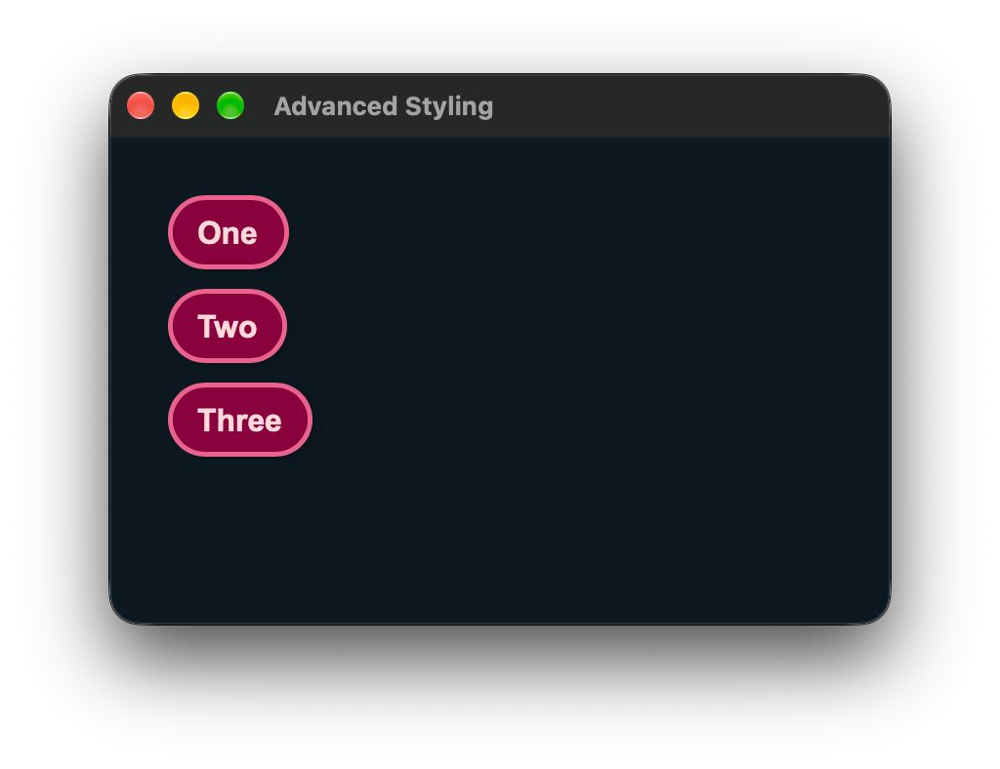

# Advanced Styling

This guide goes through some of the more advanced features of JIVE's style sheets API.

_Have a read through [Your First View](./01-Your%20First%20View.md) if you haven't already, which introduces the basics of style sheets._

## Direct Styling

The simplest way to style components is to explicitly give each component a style sheet using the `style` property.

Properties specified at the root of the style sheet are applied to the component that declares the sheet. The same sheet can be given to multiple components to share the same design.

```jsonc
// Button.json
{
  "background": "#89023E",
  "foreground": "#FFD9DA",
  "border": "#EA638C",

  "border-width": 2.5,
  "border-radius": "50%",

  "font-family": "Arial",
  "font-size": 16,

  ":hover": {
    "background": "#951748",
    "foreground": "white"
  }
}
```

```xml
<!-- View.xml -->
<Window width="400" height="250" gap="10">
  <Button style="./Button.json">One</Button>
  <Button style="./Button.json">Two</Button>
  <Button style="./Button.json">Three</Button>
</Window>
```

<p align="center">
  
</p>

This works fine for simple use-cases, but as your application scales it will become laborious to have to remember to always specify which styles to use for each component you add.

This also won't work well for shared component libraries as your templates won't know what style sheets to apply.

Instead, we should use selectors:

## Selectors

Let's add a `Styles.json` to our root component, `<Window>`:

```jsonc
// Styles.json
{
  "Button": {
    "background": "#89023E",
    "foreground": "#FFD9DA",
    "border": "#EA638C",

    "border-width": 2.5,
    "border-radius": "50%",

    "font-family": "Arial",
    "font-size": 16,

    ":hover": {
      "background": "#951748",
      "foreground": "white"
    }
  }
}
```

We've simply moved the contents of the `Button.json` style sheet to the `"Button"` property of the root style sheet. We can now change our view to use this style sheet:

```xml
<!-- View.xml -->
<Window width="400" height="250" gap="10" style="./Styles.json">
  <Button>One</Button>
  <Button>Two</Button>
  <Button>Three</Button>
</Window>
```

Now, any and all `<Button>` elements in our view will be styled the same without us having to explicitly give them a style sheet.

## Tokens

As we add more and more styles to our style sheets it's likely that they'll start reusing some of the same values:

```jsonc
{
  "Button": {
    "background": "#89023E",
    "foreground": "#FFD9DA",
    "border": "#EA638C",

    "border-width": 2.5,
    "border-radius": "50%",

    "font-family": "Arial",
    "font-size": 16,

    ":hover": {
      "background": "#951748",
      "foreground": "white"
    }
  },

  "Slider": {
    "background": "#89023E",
    "thumb": "#FFD9DA",
    "track": "#EA638C"
  }
}
```

To reduce this repetition, we can define some _tokens_ at the root of our style sheet which we can then reference elsewhere. Tokens are named variables that start with `$` that can take any value.

```jsonc
{
  "$darkRed": "#89023E",
  "$mediumRed": "#951748",
  "$pink": "#EA638C",
  "$cream": "#FFD9DA",

  "Button": {
    "background": "$darkRed",
    "foreground": "$cream",
    "border": "$pink",

    "border-width": 2.5,
    "border-radius": "50%",

    "font-family": "Arial",
    "font-size": 16,

    ":hover": {
      "background": "$mediumRed",
      "foreground": "white"
    }
  },

  "Slider": {
    "background": "$darkRed",
    "thumb": "$cream",
    "track": "$pink"
  }
}
```

For multi-value properties, tokens can also be used in place of just single values:

- `"background": "linear-gradient($dark, $light)"`
- `"shadow": "5px 5px 10px $shadowColour"`

## Advanced Selectors

There are 5 different types of selector in JIVE:

- `*` - the universal selector applies rules to every component
- `Type` - the type selector that applies rules to elements with the specified name, e.g. `Button` for `<Button>` elements. This includes your own elements, e.g. `XYPad` for `<XYPad>` elements. Each element only matches its own name, so `Button` won't match `<Checkbox>` or `<Hyperlink>` elements.
- `.class` - the class selector that applies rules to components that have the specified class in their `"class"` property.
- `#ID` - the ID selector that applies rules to only the component with the specific `"id"`.
- `:pseudo` - the pseudo-class selector that applies rules to components in the matching interaction state. `:hover`, `:active`, `:focus`, `:disabled`, and `:checked` are all supported.

### Compound Selectors

What makes selectors really powerful is that they can be combined to give styles to very specific components. We already saw an example of this in the `Button` styles above, where they have a nested `:hover` selector to match any button that the mouse is currently hovered over.

This could also be written outside of the `"Button"` selector, as `"Button:hover"`. This is called a compound selector, and they can string together as many different selectors as you like:

- `"Button.primary.large:focus:checked"` - selects buttons with the `primary` and `large` classes in their `"class"` property that currently have keyboard focus, and are toggled-on.

_The ordering doesn't matter, so `Button:focus.large:checked.primary` is identical to the one above._

### Descendant Selectors

We can also add rules that target components according to their hierarchy in the UI:

- `"#menu Button"` - select all buttons anywhere under the `#menu` component.
- `".card > .header"` - select all components that are direct children of any component with a `card` class that themselves have a `header` class.
- `".banner:focus Button:checked"` - select all buttons that are toggled-on that are anywhere under components with the `banner` class that currently have keyboard focus.

### Selector Lists

We can also specify a list in our selectors to apply the same rules to different sets of components matching any of the specified selectors.

- `"Button, ComboBox"` - select all Buttons and ComboBoxes.
- `".primary, .secondary"` - select all components with one or both of `primary` and `secondary` in their classes.
- `".card > .header, #menu Button, ComboBox:focus"` - select card headers, buttons in the menu, and combo-boxes.

## Imports

As our projects' UIs become more advanced, their style sheets will become more and more complex. You may also want to share the same design across multiple different projects but not want to repeat the same style sheets.

To solve this, JIVE's style sheets allow us to import other style sheets.

### Selector Imports

Going back to our earlier example, we can move the button's style _back_ to its own style sheet and this time use an import to include it in our root style sheet:

```jsonc
// Button.json
{
  "background": "#89023E",
  "foreground": "#FFD9DA",
  "border": "#EA638C",

  "border-width": 2.5,
  "border-radius": "50%",

  "font-family": "Arial",
  "font-size": 16,

  ":hover": {
    "background": "#951748",
    "foreground": "white"
  }
}
```

```jsonc
// RootStyles.json
{
  "Button": "./Button.json",
  "Slider": "./Slider.json",
}
```

As you can see, imports replace the JSON object that would otherwise be assigned to the selector. We can use any selector, including importing at any level of nested selectors.

Import paths work the same as the `style` property: paths starting with `./` or `../` are relative to the style sheet doing the importing, and any other paths are relative to the root. The same goes for any icon paths in the imported style sheets. Import paths must end in `.json`, which is how JIVE tells them apart from any other values.

### Sheet Imports

We still wouldn't want to have to repeat all the same imports for all the different component types, or other selectors we might use in our apps, so instead we can import entire style sheets:

```jsonc
// RootStyles.json
{
  "imports": [
    "myDesignSystem/Widgets.json",
    "myDesignSystem/Containers.json",

    "public/CustomStyles.json"
  ],

  "background": "...",
  "foreground": "...",

  "#someComponent": {
    // ...
  }
}
```

We can import multiple other style sheets and their rules will all be added along with any others specified in the root style sheet itself. Rules added later always take precedence so it's important to import style sheets in the right order to ensure any overlapping rules are resolved properly. E.g. if both `"myDesignSystem/Widgets.json"` and `"public/CustomStyles.json"` in the example above specified a background colour for sliders, the colour from `"CustomStyles.json"` would be used.

Imported style sheets can also themselves import other style sheets, e.g. `"myDesignSystem/Widgets.json"` in the above example might import style sheets for each individual widget type.

Tokens are shared between a style sheet and everything it imports, so imported sheets can use tokens without defining them themselves, as long as they're defined at the top level of the root sheet or one of the sheets it imports.
