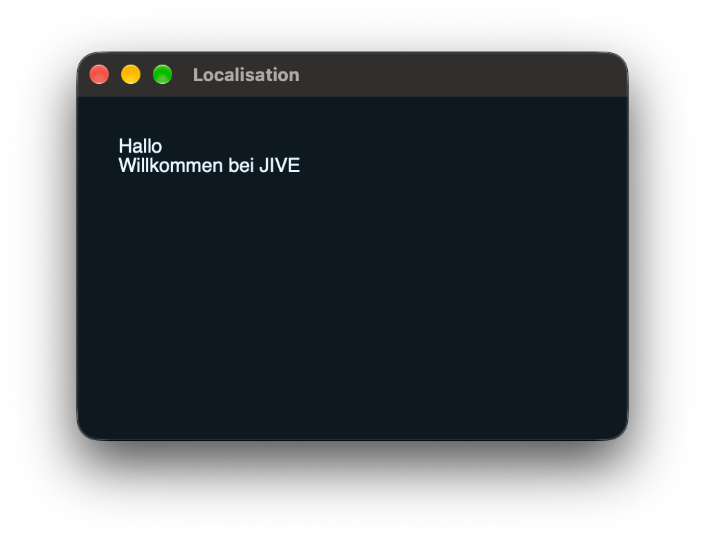
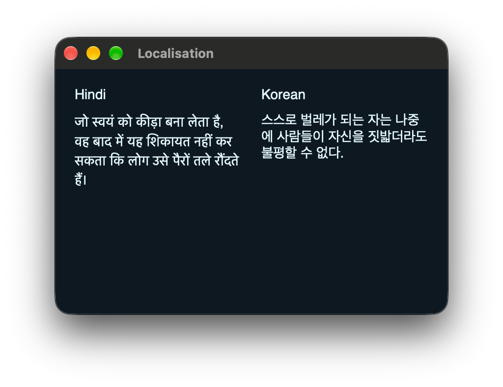
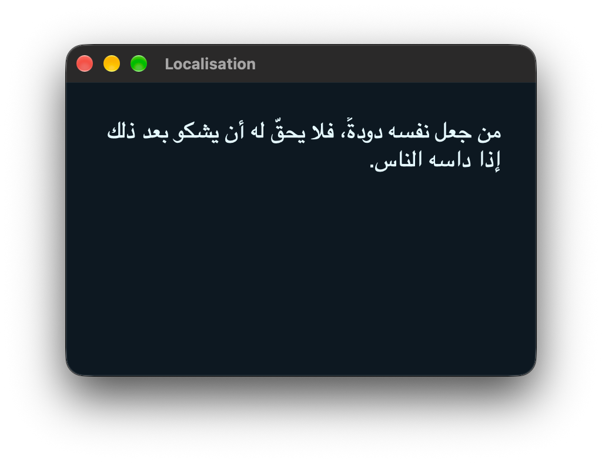

# Localisation

JIVE builds on top of JUCE's [`LocalisedStrings`](https://docs.juce.com/master/classjuce_1_1LocalisedStrings.html) API to make localising your apps and plugins as easy as possible.

## Strings Files

JUCE's `LocalisedStrings` class uses Apple's `.strings` file format. This same format is used on all platforms, not just macOS and iOS.

```strings
// french.strings

language: French
countries: fr be mc ch lu
 
"greeting" = "Bonjour"
"message" = "Bienvenue dans JIVE"
```

The format is a very simple Key-Value mapping. JUCE will look for any strings in your code wrapped in the `juce::translate()` function and replace them with the assigned translation from the current set of localised strings. If a replacement can't be found, the original string will be used.

## Localisation in JIVE

As with all sources and resources in JIVE, we should put our `.strings` files in the `public/` directory, or some other directory separate from our main source code that JIVE can bundle.

```txt
my-app/
├── public/
│   ├── locales/
│   │   ├── english.strings
│   │   ├── french.strings
│   │   ├── german.strings
│   │   └── japanese.strings
│   └── main.xml
└── source/
    └── Main.cpp
```

To choose a language, we set the `"lang"` property on an element with the path to the `.strings` file we want to load.

```xml
<!-- public/main.xml -->
<Window lang="public/locales/german.strings">
  <Text>greeting</Text>
  <Text>message</Text>
</Window>
```

<p align="center">
  
</p>

### Multi-Language Support

Unlike with `juce::translate`, which only supports one language at a time, JIVE components can each have their own language.

```xml
<!-- public/main.xml -->
<Window width="400" height="300">
  <Component lang="public/locales/hindi.strings">
    <Text>Hindi</Text>
    <Text>quote</Text>
  </Component>

  <Component lang="public/locales/korean.strings">
    <Text>Korean</Text>
    <Text>quote</Text>
  </Component>
</Window>
```

<p align="center">
  
</p>

### Right-to-Left Languages

JIVE doesn't automatically account for languages that read right-to-left. You'll need to manually specify the `"direction"` in a style sheet.

```xml
<!-- public/Main.xml -->
<Window width="400" height="250" lang="public/locales/arabic.strings">
  <Text>message</Text>
</Window>
```

```json
// public/Styles.json
{
  "Text": {
    "direction": "rtl"
  }
}
```

<p align="center">
  
</p>

## Recommended Practices

### Prefer Identifier Keys

Use identifier strings for the keys in your `.strings` files, not the English translation.

```strings
language: Japanese
countries: jp

"Avoid doing this." = "これは避けてください。"
"prefer-this" = "こちらを推奨します。"
```

```xml
<Text>Avoid doing this.</Text>
<Text>prefer-this</Text>
```

If you use English for the keys, and later want to change some of the English text, you'll have to remember to update all of the keys in all your translation files. Using identifiers instead and using an `english.strings` means you only need to update the English text in one place.

### Always Use `.strings`

Even if you don't plan to translate your app/plugin, using a `.strings` file for your text helps keep your views cleaner, especially if you have longer bodies of text.

#### Avoid

```xml
<Window width="300" height="200"> 
  <Text>“I met a genius on the train today, about 6 years old. He sat beside me and as the train ran down along the coast we came to the ocean and then he looked at me and said, ‘it's not pretty.’ It was the first time I'd realized that.”</Text>
</Window>
```

#### Prefer

```xml
<Window width="300" height="200" lang="public/locales/english.strings">
  <Text>quote</Text>
</Window>
```

```strings
language: English

"quote" = "“I met a genius on the train today, about 6 years old. He sat beside me and as the train ran down along the coast we came to the ocean and then he looked at me and said, ‘it's not pretty.’ It was the first time I'd realized that.”"
```
