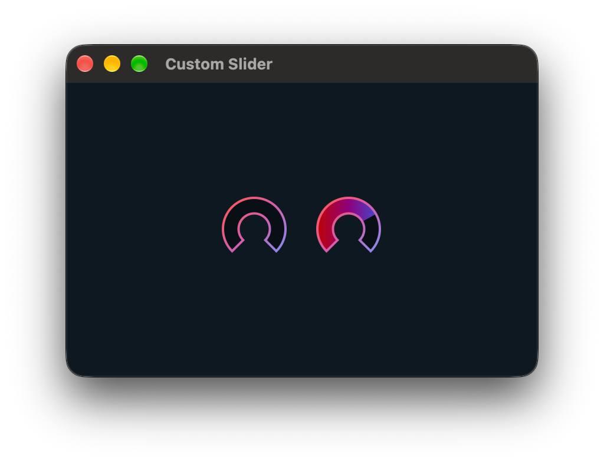
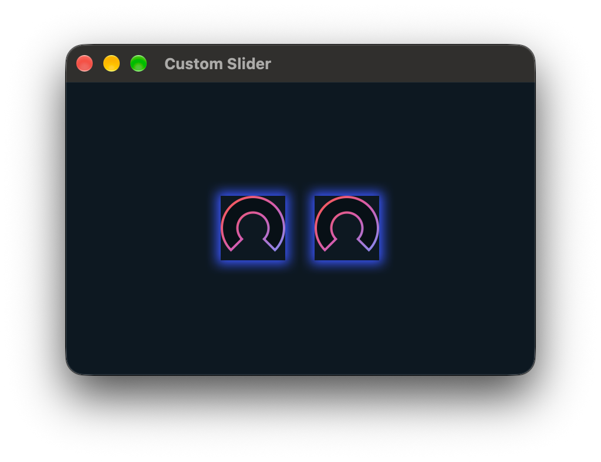
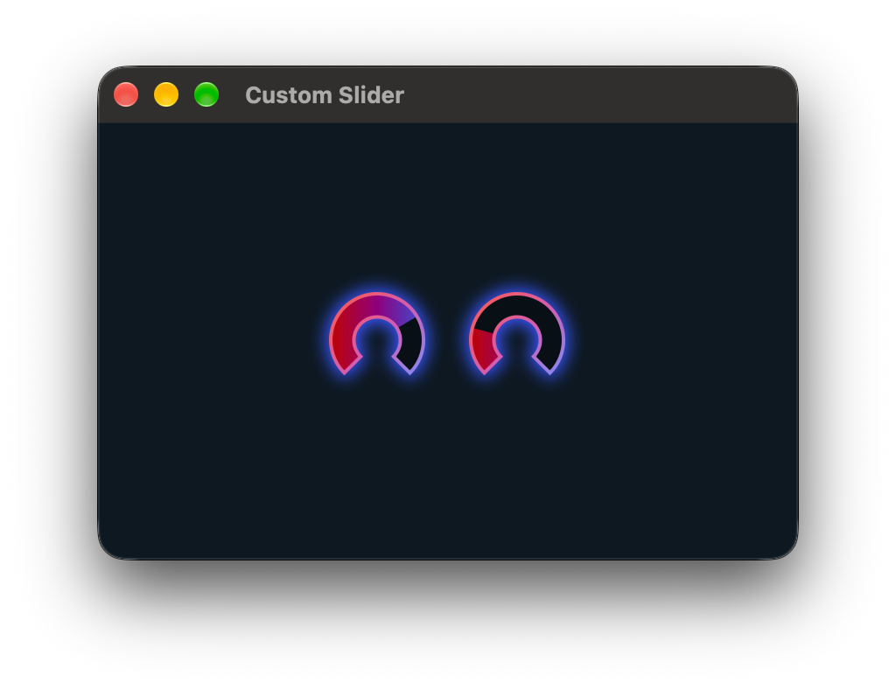
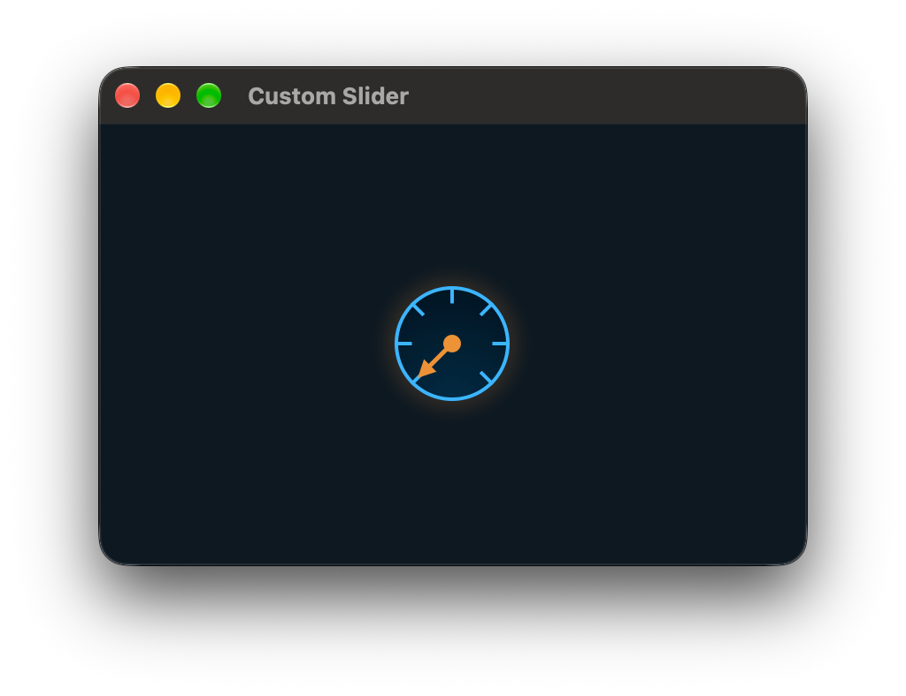
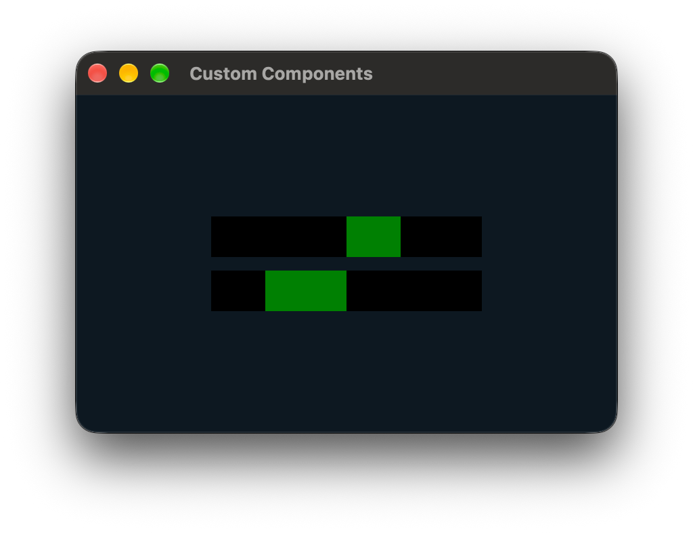
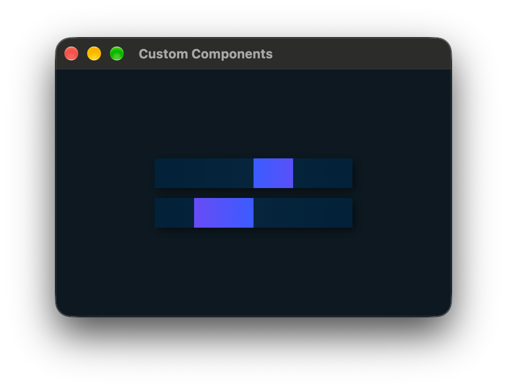

# Advanced Widget Design

JIVE's style sheets allow for the colours, fonts, and various other visual aspects of the standard widgets to be customised, but can't change the shape of components.

JIVE offers a few other approaches we can use to give custom designs to our widgets.

## Custom Painters

The quickest way to given your widgets a custom design is to add a painter to the `jive::LookAndFeel`, which is the basis for JIVE's style sheets. Painters are simply functions we give to the look-and-feel to teach it how to draw our given component.

```cpp
// The function we'll give to the look-and-feel to paint our sliders
const auto painter = [](juce::Component& component,
                        const jive::Styles& styles,
                        juce::Graphics& g) {
    auto* slider = dynamic_cast<juce::Slider*>(&component);

    if (slider == nullptr)
        return;

    const auto bounds = component.getLocalBounds().toFloat();
    const auto startAngle = -juce::MathConstants<float>::pi * 0.75f;
    const auto endAngle = juce::MathConstants<float>::pi * 0.75f;
    const auto normalisedValue = static_cast<float>(slider->getNormalisableRange().convertTo0to1(slider->getValue()));
    const auto currentAngle = startAngle + (endAngle - startAngle) * normalisedValue;

    juce::Path trackPath;
    trackPath.addPieSegment(bounds.reduced(1.0f),
                            startAngle,
                            endAngle,
                            0.5);

    auto filledPath = trackPath;
    filledPath.setUsingNonZeroWinding(false);
    filledPath.addPieSegment(bounds.reduced(1.0f),
                              currentAngle,
                              endAngle,
                              0.5);

    g.setFillType(jive::getBackgroundFill(*slider, styles));
    g.fillPath(trackPath);

    g.setFillType(jive::getTrackFill(*slider, styles));
    g.fillPath(filledPath);

    g.setFillType(jive::getBorderFill(*slider, styles));
    g.strokePath(trackPath, juce::PathStrokeType{ 2.0f });
};

// Get the JIVE look-and-feel being used by our window
auto window = interpreter.interpret(...);
auto* jiveLookAndFeel = dynamic_cast<jive::LookAndFeel*>(&window->getComponent()->getLookAndFeel());

// Register our painter function with the look-and-feel, using the "Knob"
// selector to target all <Knob> elements.
jiveLookAndFeel->addPainter("Knob", painter);
```

The painter functions take a `jive::Styles` object which contains all the styles that were specified by your style sheets that apply to the component that's being drawn. This means we can again further customise the look of our custom widgets using style sheets.

The `jive::getBackgroundFill()`, `jive::getTrackFill()`, and `jive::getBorderFill()` functions make it easier to find the right style from the styles object.

```jsonc
// public/Styles.json
{
  "Knob": {
    "background": "rgba(0, 0, 0, 0.333)",
    "track": "linear-gradient(to right, #c22b20, #853960, #007d90)",
    "border": "linear-gradient(to bottom right, #ff4a3a, #a16590, #00aac1)"
  }
}
```

<p align="center">
  
</p>

### Shadows

With how we've implemented our custom painter at the moment, if we try to add a shadow behind our slider it won't look right:

```jsonc
{
  "Knob": {
    // ...
    "shadow": "0px 0px 10px 3px #3956ff"
  }
}
```

<p align="center">
  
</p>

This is because JIVE doesn't know what shape our custom slider is, and so falls back to the default rounded rectangle.

To fix this, we can set the `"jive::shadow-path"` property on the `juce::Component` itself from our custom painter, with a string representing the shape of our custom design from `juce::Path::toString()`.

```c++
const auto painter = [](juce::Component& component,
                        const jive::Styles& styles,
                        juce::Graphics& g) {
    juce::Path trackPath;
    // ...

    component.getProperties().set(jive::ids::shadowPath(),
                                  trackPath.toString());
};
```

<p align="center">
  
</p>

## SVG Widgets

JIVE works well with SVG elements as it's very easy to change their properties from C++ at runtime. In this example we change the rotation of a needle layer in the SVG to always point at the slider's current value.

We can create a [template](./02-Templates.md) to encapsulate our slider with its SVG:

```xml
<!-- public/Slider.xml -->
<Component class="my-slider" display="block" width="65" height="65" style="./Slider.json">
    <!-- SVG with our custom slider design -->
    <svg viewBox="0 0 65 65" width="100%" height="100%" xmlns="http://www.w3.org/2000/svg">
        <circle cx="50%" cy="50%" r="31.5" stroke-width="2" />

        <!-- Value markers every 45 degrees. -->
        <line x1="50%" y1="15%" x2="50%" y2="0%" stroke-width="2" transform="rotate(-135, 32.5, 32.5)" />
        <line x1="50%" y1="15%" x2="50%" y2="0%" stroke-width="2" transform="rotate(-90, 32.5, 32.5)" />
        <line x1="50%" y1="15%" x2="50%" y2="0%" stroke-width="2" transform="rotate(-45, 32.5, 32.5)" />
        <line x1="50%" y1="15%" x2="50%" y2="0%" stroke-width="2" transform="rotate(0, 32.5, 32.5)" />
        <line x1="50%" y1="15%" x2="50%" y2="0%" stroke-width="2" transform="rotate(45, 32.5, 32.5)" />
        <line x1="50%" y1="15%" x2="50%" y2="0%" stroke-width="2" transform="rotate(90, 32.5, 32.5)" />
        <line x1="50%" y1="15%" x2="50%" y2="0%" stroke-width="2" transform="rotate(135, 32.5, 32.5)" />

        <!-- The needle that points at the current value.
             We give this an ID so we can easily refer to it in our C++ code. -->
        <g id="slider-needle" transform="rotate(0, 32.5, 32.5)">
            <line x1="50%" y1="50%" x2="50%" y2="10" stroke-width="2.5" />
            <circle cx="50%" cy="50%" r="5" />
            <polygon points="32.5,5 27.5,15 37.5,15" />
        </g>
    </svg>

    <!-- Place the actual knob over the SVG.
         We want it to be invisible but using 'visibility="false"' here will
         make it un-interactive so we'll simply set its opacity to 0 in the
         style sheet. -->
    <Knob id="knob" width="100%" height="100%" />
</Component>
```

We can then use a style sheet to define the colours and other properties of our custom design, which would allow us to overwrite these with another style sheet if we wanted a different theme in another project, but keeping the same design.

```jsonc
// public/Slider.json
{
  "$orange": "237, 146, 56",

  // Make the actual knob widget invisible so only the SVG is visible.
  "#knob": {
    "opacity": 0
  },

  "svg": {
    "shadow": "0px 0px 10px 5px rgba($orange, 0.15)",

    "> circle, > line": {
      "fill": "radial-gradient(circle at center bottom, #032A43 0%, #01131E 100%)",
      "stroke": "#3cb5ff"
    },

    "#slider-needle": {
      "> line": {
        "stroke": "rgb($orange)"
      },
      "> circle": {
        "fill": "rgb($orange)"
      },
      "> polygon": {
        "fill": "rgb($orange)"
      }
    }
  }
}
```

<p align="center">
  
</p>

### C++ Controllers

At the moment, our custom slider design won't change as we change the slider's value. To do this we'll need to create some sort of controller in C++ to listen for changes to the slider's value and to update the slider's view accordingly.

```cpp
// Get a pointer to the GUI item that manages the juce::Slider.
// This is specifically the `<Knob>` element, not the template
// component that wraps it.
auto* slider = jive::findItemWithIDAndType<jive::Slider>(*window, "knob");

// Create a handler for the slider's "on-change" event
jive::Event onSliderValueChange {
    slider->state,
    "on-change",
    [slider] {
        // Calculate the new angle of the needle using the
        // slider's current value.
        const juce::String angle{ -135 + 270 * slider->getNormalisedValue() };

        // Set the "transform" property on the needle with the new angle
        jive::findElementWithID(slider->state.getParent(), "slider-needle")
            .setProperty("transform",
                          "rotate(" + angle + ", 32.5, 32.5)",
                          nullptr);
    },
};

// Trigger the event synchronously to ensure the needle is rotated
// to the slider's initial position.
onSliderValueChange.trigger();
```

This works fine if we have just a single slider in our view using our custom design, but if we want to have multiple sliders we'll need to create an event handler for each.

```cpp
std::vector<jive::Event> sliderEvents;

// Iterate over the wrapper components which have the "my-slider" class
for (auto* const wrapper : jive::findItemsWithClass(window, "my-slider"))
{
  // Find the actual `<Knob>` element within the wrapper
  auto* slider = jive::findItemWithIDAndType<jive::Slider>(*wrapper, "knob");

  // Add a new event to the list for this slider
  auto& event = sliderEvents.emplace_back(
    slider->state,
    "on-change",
    [slider] {
      // Same handler as before...
    }
  );

  // Trigger the event synchronously
  event.trigger();
}
```

_You should populate the list in the `onLoad()` callback of `jive::Interpreter`, being sure to first clear it before adding the new events. This will ensure that any changes to the view will be accounted for and all the sliders will keep working as expected._

## Custom Components

The last approach we can take is to use an entirely custom component like we would in any JUCE app, and add bindings for it so JIVE can create and manage them for us.

This is also ideal if you have existing JUCE components that you don't want to have to rewrite using the approaches above to be able to use them with JIVE.

```c++
// StereoBalanceMeter.h
class StereoBalanceMeter : public juce::Component
{
public:
    void paint(juce::Graphics& g) override
    {
        // Find any styles that have been specified for our custom
        // component in the JIVE look-and-feel
        auto& jiveLookAndFeel = dynamic_cast<jive::LookAndFeel&>(getLookAndFeel());
        const auto styles = jiveLookAndFeel.findMostApplicableStyles(*this);

        // Optional - find any custom painters for this component
        if (const auto painter = jiveLookAndFeel.findMostApplicablePainter(*this))
        {
            (*painter)(*this, styles, g);
        }
        else
        {
            const auto bounds = getLocalBounds().toFloat();

            // Solid background
            g.setFillType(jive::findBackgroundFill(*this, styles)
                              .value_or(juce::Colours::black)
                              .toJuceFillType(bounds));
            g.fillAll();

            // Filled portion from centre
            g.setFillType(jive::findTrackFill(*this, styles)
                              .value_or(juce::Colours::green)
                              .toJuceFillType(getLocalBounds().toFloat()));

            const auto midX = bounds.proportionOfWidth(0.5f);
            const auto balanceX = bounds.proportionOfWidth((balance + 1.0f) / 2.0f);
            g.fillRect(std::min(midX, balanceX),
                        0.0f,
                        std::abs(midX - balanceX),
                        bounds.getHeight());
        }

        jiveLookAndFeel.updateShadow<StereoBalanceMeter>(*this, styles);
    }

    [[nodiscard]] auto getBalance() const noexcept
    {
        return balance;
    }

    void setBalance(float newBalance)
    {
        balance = newBalance;
        repaint();
    }

private:
    float balance = 0.0f;
};
```

To allow JIVE to manage our component for us, we need to create a custom GUI item class for it, and then register that with the interpreter we'll use to build our view.

```cpp
class StereoBalanceMeterItem : public jive::GuiItemDecorator
{
public:
    explicit StereoBalanceMeterItem(std::unique_ptr<jive::GuiItem> itemToDecorate)
        : jive::GuiItemDecorator{ std::move(itemToDecorate) }
    {
        // Set a default minimum width and height
        if (!minWidth.exists())
            minWidth = 200.0f;
        if (!minHeight.exists())
            minHeight = 30.0f;

        // Handle changes from the value-tree so our component
        // updates properly.
        // We could add as many custom properties as we like here,
        // but for this component we have just the one.
        balance.onValueChange = [this] {
            getMeter().setBalance(balance.get());
        };
        getMeter().setBalance(balance.get());
    }

private:
    [[nodiscard]] StereoBalanceMeter& getMeter()
    {
        return dynamic_cast<StereoBalanceMeter&>(*getComponent());
    }

    jive::PassiveProperty<float> balance{ state, "balance" };
    jive::PassiveProperty<float> minWidth{ state, "min-width" };
    jive::PassiveProperty<float> minHeight{ state, "min-height" };
};

// Register the component and its wrapper with our interpreter
jive::Interpreter interpreter;
auto& factory = interpreter.getComponentFactory();

factory.set("StereoBalanceMeter",
            [] {
                return std::make_shared<StereoBalanceMeter>();
            });

interpreter.addDecorator<StereoBalanceMeterItem>("StereoBalanceMeter");
```

We can now add a `<StereoBalanceMeter>` to our view, like any other widget.

```xml
<!-- public/Main.xml -->
<Window width="400" height="250">
  <StereoBalanceMeter balance="0.4"/>
  <StereoBalanceMeter balance="-0.6"/>
</Window>
```

<p align="center">
  
</p>

As before, because we used the `jive::Styles` in our custom component's painting, we can use style sheets to further customise the design:

```jsonc
{
  "StereoBalanceMeter": {
    "background": "linear-gradient(to right, #022138, #06263d, #022138)",
    "track": "linear-gradient(to right, #8540ee, #3b5cff, #8540ee)",
    "shadow": "3px 3px 10px rgba(0, 0, 0, 0.5)"
  }
}
```

<p align="center">
  
</p>
